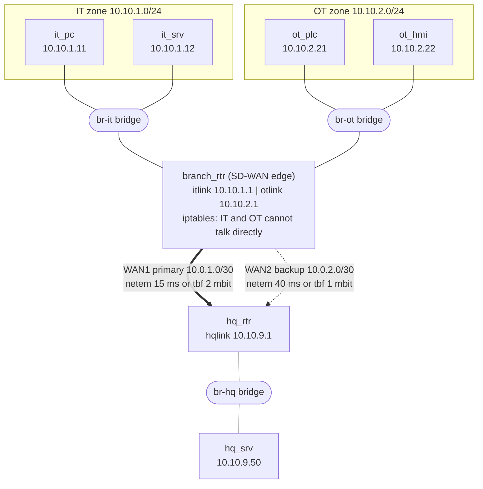
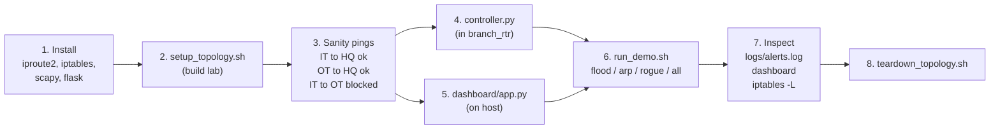
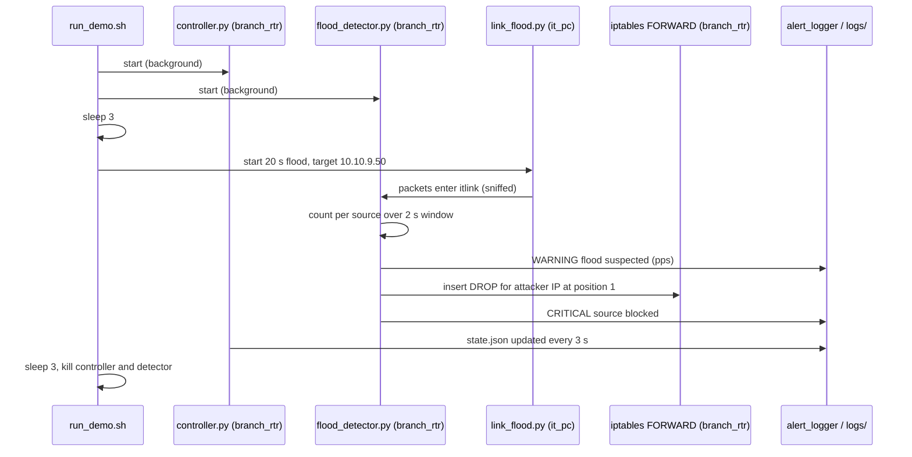
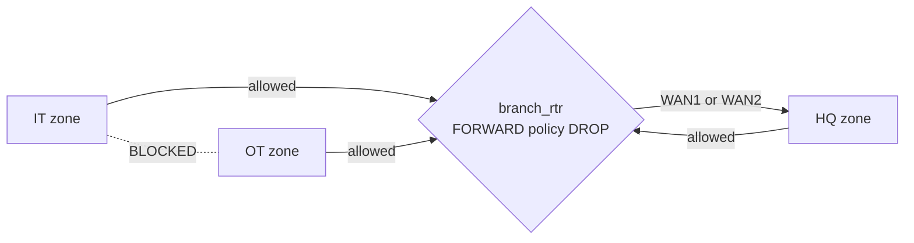
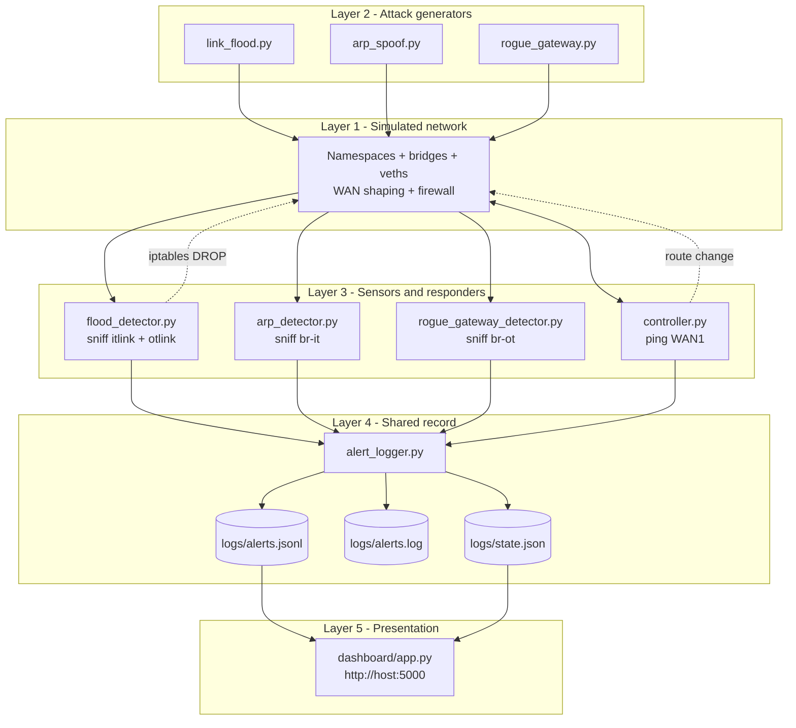
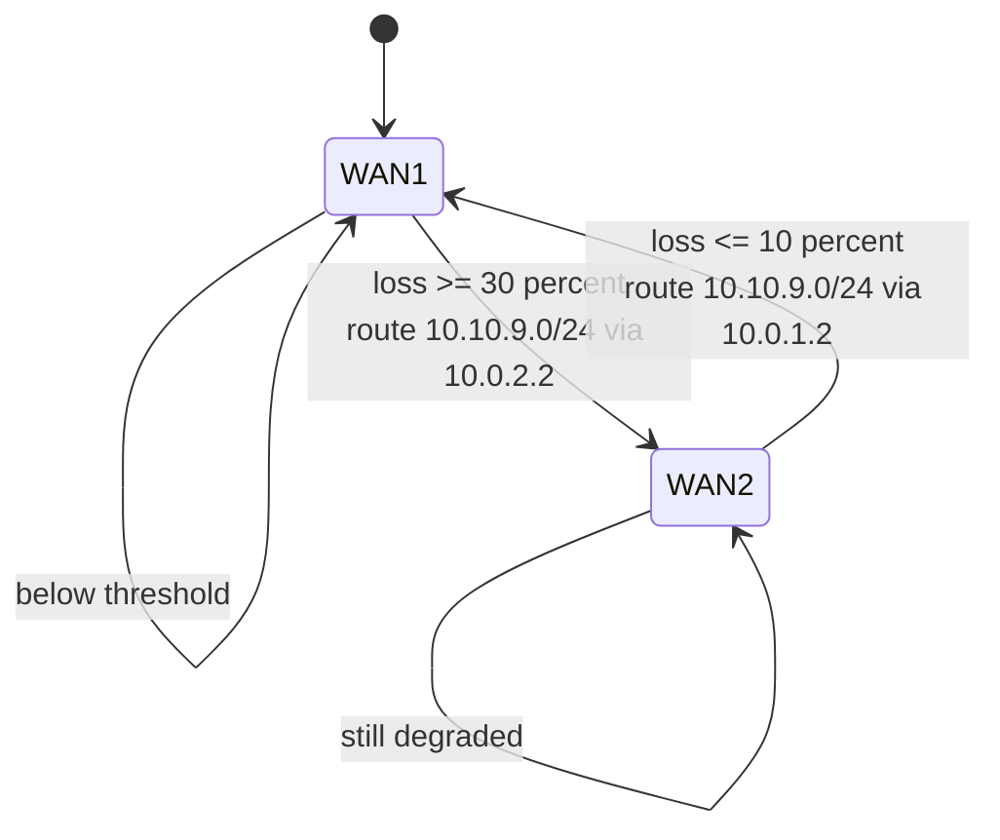

# Simulation and Detection of Network Attacks in an SD-WAN with IT/OT Segmentation

A self-contained, single-VM lab that simulates a **branch site with segmented IT and OT zones**, connected to a **head office (HQ)** over a **two-path SD-WAN** (WAN1 primary, WAN2 backup). Three network attacks are launched inside the lab, and each one has a matching detector. A path-health controller handles failover, and a live dashboard shows what is happening.

> Everything runs on one Linux machine using **network namespaces, veth pairs and Linux bridges**. No real hardware, no real network is touched.

---

## Table of contents

1. [What this project does](#1-what-this-project-does)
2. [What is being simulated](#2-what-is-being-simulated)
3. [Architecture](#3-architecture)
4. [Repository structure (every file explained)](#4-repository-structure-every-file-explained)
5. [End-to-end workflow](#5-end-to-end-workflow)
6. [IT / OT traffic flows ("calls")](#6-it--ot-traffic-flows-calls)
7. [Model flow: how data moves through the system](#7-model-flow-how-data-moves-through-the-system)
8. [Components in detail](#8-components-in-detail)
9. [Attack and detection scenarios](#9-attack-and-detection-scenarios)
10. [Sample results](#10-sample-results)
11. [Observations and design notes](#11-observations-and-design-notes)
12. [Limitations and future work](#12-limitations-and-future-work)
13. [Getting started](#13-getting-started)
14. [Command cheat sheet](#14-command-cheat-sheet)
15. [Safety and ethics](#15-safety-and-ethics)

---

## 1. What this project does

| Capability | Implemented by |
|---|---|
| Builds a virtual SD-WAN with IT, OT and HQ zones | `scripts/setup_topology.sh` |
| Enforces IT/OT segmentation (no direct IT↔OT traffic) | `iptables` rules on `branch_rtr` |
| Chooses between two WAN paths and fails over automatically | `scripts/controller.py` |
| Simulates **link flooding** (volumetric DoS) | `attacks/link_flood.py` |
| Simulates **ARP spoofing** (cache poisoning / MITM setup) in the IT zone | `attacks/arp_spoof.py` |
| Simulates a **rogue gateway** in the OT zone | `attacks/rogue_gateway.py` |
| Detects each attack, and **blocks** the flood source | `detection/*.py` |
| Records every alert in one shared format | `scripts/alert_logger.py` |
| Shows live path status and alerts in a browser | `dashboard/app.py` |

Two defensive layers work side by side:

- **Network-resilience layer** (`controller.py`): slow, ping-based, keeps the business connected by switching WAN path.
- **Security layer** (`detection/`): fast, packet-based, finds the attacker and responds (block or alert).

---

## 2. What is being simulated

**The environment.** A small company branch with two zones that must stay separated:

- **IT zone**: office PC and server (`it_pc`, `it_srv`).
- **OT zone**: industrial devices, a PLC and an HMI (`ot_plc`, `ot_hmi`).
- **HQ zone**: a head-office server (`hq_srv`).

The branch router (`branch_rtr`) acts as the SD-WAN edge. It has two uplinks to HQ and a firewall policy that lets IT and OT reach HQ but never each other.

**The attacks.** What an attacker who has already compromised one internal host could do:

| # | Attack | Where it starts | What it tries to achieve |
|---|---|---|---|
| 1 | **Link flooding** | `it_pc` (IT zone) | Saturate the WAN path to HQ so legitimate traffic suffers |
| 2 | **ARP spoofing** | `it_srv` (IT zone) | Make `it_pc` believe the attacker is the gateway (man-in-the-middle position) |
| 3 | **Rogue gateway** | `ot_hmi` (OT zone) | Claim the OT gateway IP so PLC traffic could be intercepted or dropped |

**The defenses.** What the lab shows in response:

| Threat | Defense | Type of response |
|---|---|---|
| IT ↔ OT lateral movement | Interface-based `iptables` DROP on `branch_rtr` | Preventive |
| WAN1 degradation | `controller.py` fails over to WAN2, fails back on recovery | Availability |
| Link flood | `flood_detector.py` counts packets/sec per source | Detect **and block** |
| ARP spoofing | `arp_detector.py` spots one IP claimed by two MACs | Detect and alert |
| Rogue gateway | `rogue_gateway_detector.py` compares claimant MAC to a trusted baseline | Detect and alert |

---

## 3. Architecture

### 3.1 Logical topology



### 3.2 How it is physically built on one machine

| Linux feature | Used for |
|---|---|
| **Network namespaces** (7) | Each device gets its own isolated network stack: `it_pc`, `it_srv`, `ot_plc`, `ot_hmi`, `branch_rtr`, `hq_rtr`, `hq_srv` |
| **veth pairs** | Virtual cables. One end sits inside a namespace, the other is plugged into a bridge (or into the other router for WAN links) |
| **Linux bridges** (3, in the host) | Virtual switches: `br-it`, `br-ot`, `br-hq`. The host can sniff them, which is how the ARP and rogue-gateway detectors see zone traffic |
| **`ip route`** | Default routes on hosts, static route for HQ on `branch_rtr` (changed by the controller) |
| **`iptables`** | Segmentation policy and the flood-block rule |
| **`tc` (netem / tbf)** | Makes WAN1 and WAN2 behave like real links with delay or a bandwidth cap |

### 3.3 Address plan

| Segment | Subnet | Members |
|---|---|---|
| IT zone | `10.10.1.0/24` | `it_pc` .11, `it_srv` .12, gateway `branch_rtr` .1 |
| OT zone | `10.10.2.0/24` | `ot_plc` .21, `ot_hmi` .22, gateway `branch_rtr` .1 |
| WAN1 (primary) | `10.0.1.0/30` | `branch_rtr` .1, `hq_rtr` .2 |
| WAN2 (backup) | `10.0.2.0/30` | `branch_rtr` .1, `hq_rtr` .2 |
| HQ zone | `10.10.9.0/24` | `hq_srv` .50, gateway `hq_rtr` .1 |

### 3.4 Interface map

| Namespace | Interface | Address | Connects to |
|---|---|---|---|
| `it_pc` / `it_srv` | `it0` | 10.10.1.11 / .12 | `br-it` via `veth-itpc-h` / `veth-itsrv-h` |
| `ot_plc` / `ot_hmi` | `ot0` | 10.10.2.21 / .22 | `br-ot` via `veth-otplc-h` / `veth-othmi-h` |
| `hq_srv` | `hq0` | 10.10.9.50 | `br-hq` via `veth-hqsrv-h` |
| `branch_rtr` | `itlink` | 10.10.1.1 | `br-it` via `veth-br-it-h` |
| `branch_rtr` | `otlink` | 10.10.2.1 | `br-ot` via `veth-br-ot-h` |
| `branch_rtr` | `wan1-br` / `wan2-br` | 10.0.1.1 / 10.0.2.1 | `hq_rtr` `wan1-hq` / `wan2-hq` |
| `hq_rtr` | `hqlink` | 10.10.9.1 | `br-hq` via `veth-hqrtr-h` |

> Interface names are deliberately project-specific (never `eth0`) so creating them cannot disturb the host's real network. See [`docs/LIMITATIONS.md`](docs/LIMITATIONS.md).

### 3.5 Segmentation policy (on `branch_rtr`)

`FORWARD` policy is **DROP** (default deny). Only these are allowed:

| Rule | Effect |
|---|---|
| `itlink ↔ wan1-br`, `itlink ↔ wan2-br` ACCEPT | IT ↔ HQ allowed over either WAN |
| `otlink ↔ wan1-br`, `otlink ↔ wan2-br` ACCEPT | OT ↔ HQ allowed over either WAN |
| `itlink → otlink` DROP, `otlink → itlink` DROP | **IT ↔ OT blocked** (explicit, for clarity and counters) |
| *(added at runtime)* `-s <attacker> -j DROP` inserted at position 1 | Flood source blocked by `flood_detector.py` |

### 3.6 WAN path selection

WAN1 is preferred because it has the lower delay (or higher bandwidth in the `tbf` fallback). `branch_rtr` holds one route for the HQ network (`10.10.9.0/24`), which the controller moves between `wan1-br → 10.0.1.2` and `wan2-br → 10.0.2.2`.

---

## 4. Repository structure (every file explained)

```
.
├── README.md                          This report
├── .gitignore                         Ignores runtime logs and Python caches
├── scripts/
│   ├── setup_topology.sh              Builds namespaces, bridges, veths, IPs, routes, firewall, WAN shaping
│   ├── teardown_topology.sh           Removes everything setup_topology.sh created
│   ├── controller.py                  WAN1 health check + failover/fail-back (runs in branch_rtr)
│   ├── alert_logger.py                Shared alert + state writer/reader (imported by everything else)
│   └── run_demo.sh                    One-command wrapper for the three scenarios
├── attacks/
│   ├── link_flood.py                  Attack 1: UDP flood toward HQ
│   ├── arp_spoof.py                   Attack 2: forged ARP replies for the IT gateway
│   └── rogue_gateway.py               Attack 3: gratuitous ARP claiming the OT gateway
├── detection/
│   ├── flood_detector.py              Detects (and blocks) high packet rate per source
│   ├── arp_detector.py                Detects one IP claimed by two MACs
│   └── rogue_gateway_detector.py      Detects gateway IP claimed by an untrusted MAC
├── dashboard/
│   └── app.py                         Flask web UI + JSON API
├── logs/                              Created at runtime (.gitkeep keeps the folder in git)
└── docs/
    ├── LIMITATIONS.md                 Scope cuts, kernel notes, fault-injection test
    ├── QUICKSTART_ORIGINAL.md         The original short README (kept for reference)
    └── sample_results/                Real captured output from working runs
        ├── README.md
        ├── flood_detect_and_block.log
        ├── arp_spoof_detect.log
        ├── rogue_gateway_detect.log
        └── failover_failback.log
```

### File-by-file meaning

| File | Runs where | Role |
|---|---|---|
| `scripts/setup_topology.sh` | Host, as root | Creates the whole lab in the order: namespaces → bridges → veth links → IPs → bring up → default routes → HQ routes → forwarding → firewall → WAN shaping |
| `scripts/teardown_topology.sh` | Host, as root | Deletes namespaces, veth ends, and bridges. Safe to re-run |
| `scripts/controller.py` | Inside `branch_rtr` | Pings `10.0.1.2` (WAN1 peer) every 3 s and swaps the HQ route when loss crosses thresholds |
| `scripts/alert_logger.py` | Imported | `log_alert()` writes JSONL + text + stdout. `set_state()/get_state()` keep the small shared status file. `read_alerts()` feeds the dashboard |
| `scripts/run_demo.sh` | Host, as root | Starts the right detector(s) in the background, launches the attack from the right namespace, stops detectors, writes console output to `logs/` |
| `attacks/link_flood.py` | Inside `it_pc` | Scapy UDP flood of 1400-byte payloads to `10.10.9.50:9999` |
| `attacks/arp_spoof.py` | Inside `it_srv` | Sends forged ARP "is-at" saying the gateway IP belongs to the attacker's MAC |
| `attacks/rogue_gateway.py` | Inside `ot_hmi` | Broadcasts gratuitous ARP claiming `10.10.2.1` |
| `detection/flood_detector.py` | Inside `branch_rtr` | Sniffs `itlink`/`otlink`, counts packets per source IP per 2 s window |
| `detection/arp_detector.py` | Host (on `br-it`) | Learns IP→MAC from ARP, alerts on conflict |
| `detection/rogue_gateway_detector.py` | Host (on `br-ot`) | Alerts when a MAC other than the trusted one claims the OT gateway IP |
| `dashboard/app.py` | Host | Reads `logs/` and renders status page (auto-refresh 3 s) and `/api/*` JSON |

---

## 5. End-to-end workflow

### 5.1 Run order



### 5.2 What happens inside one scenario (flood example)



### 5.3 What `run_demo.sh` does per scenario

| Scenario | Starts | Attacker command (summary) | Output files in `logs/` |
|---|---|---|---|
| `flood` | `controller.py` and `flood_detector.py` in `branch_rtr`. Clears old alerts first | `it_pc`: `link_flood.py --pps 3000 --duration 20` | `controller_console.log`, `flood_detector_console.log`, `attack_console.log` |
| `arp` | `arp_detector.py --iface br-it` on host | `it_srv`: `arp_spoof.py --victim 10.10.1.11 --gateway 10.10.1.1 --duration 15` | `arp_detector_console.log`, `arp_attack_console.log` |
| `rogue` | `rogue_gateway_detector.py --iface br-ot`, trusted MAC read from `branch_rtr`'s `otlink` | `ot_hmi`: `rogue_gateway.py --gateway-ip 10.10.2.1 --duration 15` | `rogue_gw_detector_console.log`, `rogue_gw_attack_console.log` |
| `all` | The three above, one after another | | `alerts.log`, `alerts.jsonl`, `state.json` |

---

## 6. IT / OT traffic flows ("calls")

The lab uses **ICMP, UDP and ARP** to represent traffic. It does not run real industrial protocols (Modbus, DNP3, OPC UA); the PLC and HMI are namespaces standing in for those devices, so what matters is *who can reach whom* and *what is visible on the wire*.

### 6.1 Allowed and blocked flows

| From → To | Example call | Path | Result | Why |
|---|---|---|---|---|
| IT → HQ | `ip netns exec it_pc ping 10.10.9.50` | `it_pc` → br-it → `branch_rtr` (itlink → active WAN) → `hq_rtr` → br-hq → `hq_srv` | **Allowed** | `itlink → wan*-br` ACCEPT |
| OT → HQ | `ip netns exec ot_plc ping 10.10.9.50` | `ot_plc` → br-ot → `branch_rtr` (otlink → active WAN) → `hq_rtr` → `hq_srv` | **Allowed** | `otlink → wan*-br` ACCEPT |
| HQ → IT / OT | `ip netns exec hq_srv ping 10.10.1.11` | `hq_srv` → `hq_rtr` → WAN1 (static return route) → `branch_rtr` → zone | **Allowed** | `wan*-br → itlink/otlink` ACCEPT |
| **IT → OT** | `ip netns exec it_pc ping 10.10.2.21` | `it_pc` → `branch_rtr` (itlink) → would exit `otlink` | **Blocked** | `itlink → otlink` DROP |
| **OT → IT** | `ip netns exec ot_plc ping 10.10.1.11` | `ot_plc` → `branch_rtr` (otlink) → would exit `itlink` | **Blocked** | `otlink → itlink` DROP |
| Same-zone (IT↔IT, OT↔OT) | `it_pc` → `it_srv` | Switched on the bridge only, never reaches the router | Allowed | Layer-2 traffic |



### 6.2 Attack traffic ("calls" the attackers make)

| Attack | Packet type crafted (Scapy) | Crosses the router? | Seen by |
|---|---|---|---|
| Link flood | `IP(dst=10.10.9.50)/UDP(sport=40000,dport=9999)/Raw(1400 B)` in bursts of `pps/50` | **Yes**, toward the WAN | `flood_detector` sniffing `itlink`/`otlink` |
| ARP spoof | Ethernet broadcast + `ARP(op=2 is-at, psrc=10.10.1.1, hwsrc=attacker MAC, pdst=10.10.1.11)` every 2 s | **No**, stays inside the IT broadcast domain | `arp_detector` sniffing `br-it` |
| Rogue gateway | Ethernet broadcast + gratuitous `ARP(op=2, psrc=pdst=10.10.2.1, hwsrc=attacker MAC)` every 1 s | **No**, stays inside the OT broadcast domain | `rogue_gateway_detector` sniffing `br-ot` |

### 6.3 Monitoring and control calls

| Caller | Call | Target | Purpose |
|---|---|---|---|
| `controller.py` | `ping -c 5 -W 1 -i 0.2 -w 2 10.0.1.2` every 3 s | `hq_rtr` WAN1 address | Measure WAN1 loss |
| `controller.py` | `ip route del/add 10.10.9.0/24 ...` | `branch_rtr` routing table | Switch active path |
| `flood_detector.py` | `iptables -I FORWARD 1 -s <ip> -j DROP` | `branch_rtr` firewall | Block flooder |
| `run_demo.sh` | `cat /sys/class/net/otlink/address` | `branch_rtr` | Get trusted gateway MAC |
| Browser / script | `GET /`, `/api/state`, `/api/alerts` | `dashboard/app.py` :5000 | View status |

---

## 7. Model flow: how data moves through the system



**Reading the diagram.** Attacks create traffic in the network layer. Sensors observe it (packet sniffing or ping probes), decide, and write through `alert_logger`. The dashboard only *reads* the files, so it can run anywhere on the host and never needs to enter a namespace. Dotted arrows are the two **active responses**: the flood block and the WAN route change.

### 7.1 Alert record format (`logs/alerts.jsonl`)

One JSON object per line:

```json
{"timestamp": "2026-11-11 17:56:33", "source": "flood_detector", "severity": "critical",
 "message": "Blocked 10.10.1.11 at branch_rtr (iptables FORWARD DROP) after sustained flood.",
 "attacker_ip": "10.10.1.11"}
```

| Field | Meaning |
|---|---|
| `timestamp` | Local time, `YYYY-MM-DD HH:MM:SS` |
| `source` | `controller`, `flood_detector`, `arp_detector`, `rogue_gateway_detector` |
| `severity` | `info`, `warning`, `critical` |
| `message` | Human-readable sentence |
| extra fields | Detector-specific, e.g. `attacker_ip`, `pps`, `previous_mac`, `new_mac`, `rogue_mac`, `trusted_mac`, `wan1_loss_pct` |

`logs/state.json` holds the live status: `active_path`, `wan1_loss_pct`, `updated`.

---

## 8. Components in detail

### 8.1 Controller (`scripts/controller.py`)

Runs inside `branch_rtr` and implements a two-state machine with hysteresis so the route does not flap.



| Parameter | Value | Meaning |
|---|---|---|
| `PING_COUNT` | 5 | Probes per check, so loss is measured in 20 % steps |
| `PING_DEADLINE` | 2 s | Upper bound for one probe burst |
| `POLL_INTERVAL` | 3 s | Pause between checks |
| `FAILOVER_LOSS_PCT` | 30 | Fail over when 2 or more of 5 probes are lost |
| `RECOVER_LOSS_PCT` | 10 | Fail back only when all 5 probes succeed (0 % loss) |

Always probes WAN1's peer (`10.0.1.2`), even while on WAN2, so it can tell when WAN1 is healthy again. Each transition is logged as an alert and `state.json` is updated.

### 8.2 Alert logger (`scripts/alert_logger.py`)

The single point every component writes through. `log_alert(source, severity, message, **extra)` appends to `alerts.jsonl` and `alerts.log` and prints to the console. `set_state()` merges fields into `state.json`. `read_alerts(limit=200)` returns the most recent alerts for the dashboard.

### 8.3 Dashboard (`dashboard/app.py`)

| Route | Returns |
|---|---|
| `/` | HTML page: active WAN path (green for WAN1, amber otherwise), WAN1 loss, last update, and an alert table (newest first, critical rows shaded red, warning rows amber). Auto-refreshes every 3 s |
| `/api/state` | JSON of `state.json` |
| `/api/alerts` | JSON list of the latest alerts |

Listens on `0.0.0.0:5000`. There is no authentication; treat it as a lab tool only.

---

## 9. Attack and detection scenarios

### Scenario 1: Link flooding

| | |
|---|---|
| **Goal of the attacker** | Saturate the path to HQ so business and OT traffic suffers |
| **Attack** | `it_pc` sends a high-rate UDP stream (1400-byte payload) to `hq_srv:9999` |
| **Detector** | `flood_detector.py`, inside `branch_rtr` |
| **Detection logic** | Sniff `itlink` and `otlink`. Every 2 s, compute packets/sec per source IP. If any source reaches **300 pps**, alert |
| **Response** | Insert `iptables -I FORWARD 1 -s <ip> -j DROP`, once per source |
| **Related resilience** | If the flood degrades WAN1 enough, `controller.py` fails over to WAN2 |
| **Defender takeaway** | Fast detection and blocking often stops the flood before the slower ping-based controller would ever need to fail over |

MITRE ATT&CK reference: *Network Denial of Service* (T1498).

### Scenario 2: ARP spoofing in the IT zone

| | |
|---|---|
| **Goal of the attacker** | Become the "gateway" for `it_pc` (man-in-the-middle position) |
| **Attack** | `it_srv` sends forged ARP replies: "`10.10.1.1` is at *attacker MAC*", every 2 s |
| **Detector** | `arp_detector.py`, on the host, sniffing `br-it` |
| **Detection logic** | Maintain an IP→MAC table from observed ARP. If one IP is later claimed by a different MAC, raise a **critical** alert |
| **Response** | Alert (the offending MAC is also remembered in an internal set) |

MITRE ATT&CK reference: *Adversary-in-the-Middle: ARP Cache Poisoning* (T1557.002).

### Scenario 3: Rogue gateway in the OT zone

| | |
|---|---|
| **Goal of the attacker** | Claim the OT gateway address so PLC traffic flows through the attacker |
| **Attack** | `ot_hmi` broadcasts gratuitous ARP: "`10.10.2.1` is at *attacker MAC*", every 1 s |
| **Detector** | `rogue_gateway_detector.py`, on the host, sniffing `br-ot` |
| **Detection logic** | Only look at ARP replies for the gateway IP. Compare the claiming MAC against a **trusted MAC** supplied at start-up (the real `otlink` MAC) |
| **Response** | Critical alert on every non-trusted claim |

**Why two ARP detectors?** `arp_detector` is a general sensor that learns from traffic ("any IP seen with two MACs"). `rogue_gateway_detector` is a targeted, policy-based check against a known-good value, so it is not fooled if the attacker speaks first.

---

## 10. Sample results

Captured from real runs and stored in [`docs/sample_results/`](docs/sample_results/). Your own run will differ in timestamps and MAC addresses.

### Flood detected and blocked

```
[17:56:28] (INFO)     controller: Controller started. Active path: WAN1
[17:56:29] (INFO)     flood_detector: Flood detector started (threshold=300 pps, window=2s) on ['itlink', 'otlink'].
[17:56:33] (WARNING)  flood_detector: Link flooding suspected from 10.10.1.11 (~375 pkt/s).
[17:56:33] (CRITICAL) flood_detector: Blocked 10.10.1.11 at branch_rtr (iptables FORWARD DROP) after sustained flood.
[17:56:35] (WARNING)  flood_detector: Link flooding suspected from 10.10.1.11 (~1005 pkt/s).
```

Attacker side: about 18,240 packets sent in 20 s. `iptables` then shows `DROP` for `10.10.1.11` as rule 1 in `FORWARD`.

### ARP spoofing detected

```
(INFO)     arp_detector: ARP spoof detector started on br-it (IT zone).
(CRITICAL) arp_detector: ARP spoofing suspected in IT: 10.10.1.1 was ca:ba:60:c9:c5:b8, now claimed by 26:92:a0:01:b3:99.
(CRITICAL) arp_detector: ARP spoofing suspected in IT: 10.10.1.1 was 26:92:a0:01:b3:99, now claimed by ca:ba:60:c9:c5:b8.
```

### Rogue gateway detected

```
(INFO)     rogue_gateway_detector: ... Trusted MAC for 10.10.2.1 is 2a:a6:e2:41:e4:5c.
(CRITICAL) rogue_gateway_detector: Rogue gateway detected: 10.10.2.1 claimed by 1e:af:66:c2:a2:f0, expected 2a:a6:e2:41:e4:5c.
```

### Failover and fail-back (fault-injected WAN1 outage)

```
(INFO)    controller: Controller started. Active path: WAN1
(WARNING) controller: WAN1 degraded (loss=90%). Failing over to WAN2.
(INFO)    controller: WAN1 recovered (loss=0%). Failing back to WAN1.
```

---

## 11. Observations and design notes

These are behaviours visible in the code and sample logs. They are useful to mention when presenting results.

1. **The first ARP seen becomes the baseline.** `arp_detector` has no preloaded trust list. In the sample log the attacker's claim was seen first, so the *attacker's* MAC was stored as the "previous" one. The two alerts that follow are the same conflict seen from both directions (spoof, then the real router's reply). A trusted-MAC list, as in `rogue_gateway_detector`, would remove this ambiguity.
2. **ARP detection is alert-only.** `arp_detector` adds the claiming MAC to an internal `_blocked_macs` set, but nothing enforces it. Only the flood detector takes an active blocking action.
3. **Flood alerts continue after the block.** The detector sniffs at the interface, before the firewall `FORWARD` chain, so it still sees the attacker's packets and keeps alerting, but it blocks each source only once.
4. **No unblock.** Blocks do not expire. `teardown_topology.sh` removes them with the namespace.
5. **Why failover may not appear during a flood.** The detector usually blocks the attacker within one or two 2-second windows, before the controller's 3-second ping loop sees enough loss. This is documented in `docs/LIMITATIONS.md`, along with a fault-injection way to test the controller on its own.
6. **Controller probes are independent of the firewall block.** The controller's pings originate from `branch_rtr` itself (OUTPUT chain), so a `FORWARD` drop against an IT source never interferes with health checks.
7. **Shaping mode matters.** With `netem`, WAN links get delay (15 ms / 40 ms) but no explicit rate cap. With the `tbf` fallback, WAN1 is capped at 2 Mbit and WAN2 at 1 Mbit, which gives clearer congestion. Check with `ip netns exec branch_rtr tc qdisc show dev wan1-br`.
8. **The ARP attacks are broadcast.** Both ARP scripts send to `ff:ff:ff:ff:ff:ff`, so every host in the zone hears them, which also makes them visible to the bridge-level sensors.

---

## 12. Limitations and future work

Scope was kept at an intermediate level on purpose. Details in [`docs/LIMITATIONS.md`](docs/LIMITATIONS.md).

| Limitation | Effect | Possible improvement |
|---|---|---|
| HQ return routes are static via WAN1 | After a failover, the return path from HQ is not re-routed | Dynamic or symmetric routing on both edges |
| Segmentation is interface-based only | HQ can reach OT on any port; no protocol filtering | Add an IT/OT DMZ and port/protocol allow-lists (e.g. only the specific industrial protocol between named hosts) |
| No real industrial protocol traffic | PLC/HMI behaviour is not modelled | Add Modbus/TCP or OPC UA test traffic and protocol-aware detection |
| WAN links are unencrypted | No VPN/tunnel realism | Add WireGuard/IPsec between the routers |
| Threshold detection only | A fixed 300 pps may be wrong for other environments | Adaptive baselines, rate-per-flow analysis |
| ARP detection is alert-only | Spoofing continues after detection | Switch port security, static ARP on critical hosts, dynamic ARP inspection, or automatic MAC blocking |
| Flood detector and controller are not linked | They act independently | Let the detector notify the controller |
| Alerts go to local files | No central SOC view | Forward to a SIEM such as Wazuh |
| Dashboard has no auth or TLS | Lab use only | Add authentication and run behind a reverse proxy |

---

## 13. Getting started

### Requirements

- A Linux VM (design target: Ubuntu 22.04 or 24.04), with **root** access
- `iproute2`, `iptables`, `python3-pip`
- Python packages `scapy` and `flask`

```bash
sudo apt update
sudo apt install -y iproute2 iptables python3-pip
pip install scapy flask --break-system-packages    # or use a virtual environment
```

### Step 1: Build the topology

```bash
sudo bash scripts/setup_topology.sh
```

### Step 2: Sanity-check

```bash
sudo ip netns exec it_pc  ping -c3 10.10.9.50   # IT -> HQ : works
sudo ip netns exec ot_plc ping -c3 10.10.9.50   # OT -> HQ : works
sudo ip netns exec it_pc  ping -c3 10.10.2.21   # IT -> OT : blocked
```

### Step 3: Start the controller (terminal 1)

```bash
sudo ip netns exec branch_rtr python3 scripts/controller.py
```

### Step 4: Start the dashboard (terminal 2)

```bash
python3 dashboard/app.py          # open http://<vm-ip>:5000
```

### Step 5: Run the scenarios (terminal 3)

```bash
sudo bash scripts/run_demo.sh flood
sudo bash scripts/run_demo.sh arp
sudo bash scripts/run_demo.sh rogue
sudo bash scripts/run_demo.sh all
```

> `run_demo.sh flood` starts its own controller and clears old logs. If you already have a controller running from Step 3, stop it first to avoid two controllers writing the same state file.

### Step 6: Tear down

```bash
sudo bash scripts/teardown_topology.sh
```

### Test failover on its own (fault injection)

```bash
# Simulate a WAN1 outage
sudo ip netns exec branch_rtr iptables -I OUTPUT 1 -p icmp -d 10.0.1.2 -j DROP
# watch logs/state.json flip to WAN2, then restore:
sudo ip netns exec branch_rtr iptables -D OUTPUT -p icmp -d 10.0.1.2 -j DROP
# watch it fail back to WAN1
```

---

## 14. Command cheat sheet

| Task | Command |
|---|---|
| List namespaces | `ip netns list` |
| Shell inside a node | `sudo ip netns exec branch_rtr bash` |
| Show router firewall | `sudo ip netns exec branch_rtr iptables -L FORWARD -n -v --line-numbers` |
| Show router routes | `sudo ip netns exec branch_rtr ip route` |
| Show WAN shaping | `sudo ip netns exec branch_rtr tc qdisc show dev wan1-br` |
| Show a victim's ARP table | `sudo ip netns exec it_pc ip neigh` |
| Follow alerts | `tail -f logs/alerts.log` |
| Current state (JSON) | `curl http://127.0.0.1:5000/api/state` |
| All alerts (JSON) | `curl http://127.0.0.1:5000/api/alerts` |
| Attack/detector options | `python3 attacks/link_flood.py --help` (same for each script) |

---

## 15. Safety and ethics

All attacks run **only** inside the private namespaces created by `setup_topology.sh`. They never touch a real network, Wi-Fi or Ethernet segment, or any machine outside the lab. Do not point `link_flood.py`, `arp_spoof.py` or `rogue_gateway.py` at an interface or IP outside this topology. The project is for education, defensive research and demonstration.
